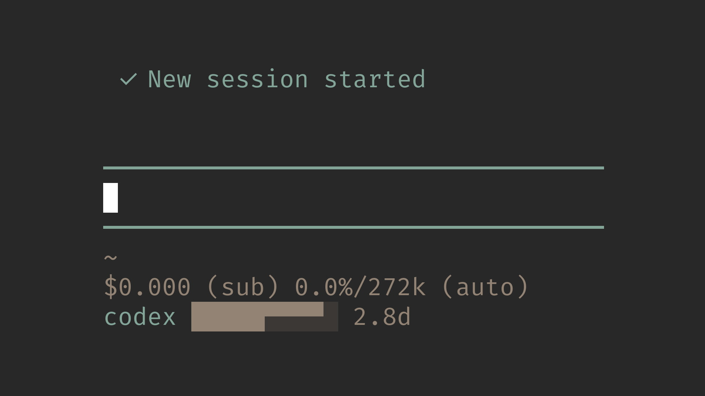

# pi-codex-usage

> Pi extension for ChatGPT Codex usage limits and a local Fast toggle



This extension owns **usage state + usage mode**: zero-configuration quota reporting, plus an optional per-model Fast preference. Shared command arbitration and JSONC editing belong to [`@llblab/pi-command-fast`](https://github.com/llblab/pi-command-fast), a normal dependency, not another Pi extension.

This repository is a minimal fork of [`narumiruna/pi-extensions/extensions/pi-codex-usage`](https://github.com/narumiruna/pi-extensions/tree/main/extensions/pi-codex-usage). It keeps the auth and quota-fetching path, but intentionally narrows the interface to the Codex quota windows returned by OpenAI.

## Start Here

- [Agent Notes](./AGENTS.md)
- [Backlog](./BACKLOG.md)
- [Changelog](./CHANGELOG.md)

## Features

- Shows two counter-moving half-height markers in the statusline bar while Codex usage is loading, then keeps the bar fresh (the countdown ticks locally)
- Keeps the last usable bar visible during ordinary refreshes instead of replacing known quota with a loading state
- Statusline output adapts to the response: weekly-only limits show an explicit remaining percentage and reset countdown, while dual-window limits keep the compact themed bar
- Models under either `openai-codex` or `openai` show the same primary Codex subscription quota and `codex` status label (not OpenAI API billing limits)
- When `pi-telegram` is available, the same compact value appears as `codex: <value>` in the `/start` menu status text for either supported provider
- Additional returned quota buckets are ignored
- Both Pi OpenAI OAuth methods are detected; legacy-compatible Pi/Codex CLI credentials are used for the direct quota request
- Codex CLI app-server remains available as a fallback
- Missing auth, subscription, plan, or quota windows are shown as `n/a`, not as an error
- Successful updates briefly redraw the bar only when a 5% segment changes
- Network/provider failures keep the last good bar (up to an hour), then show `error`
- Any number of Pi instances share one request stream, see [Shared Refresh](#shared-refresh)
- Quota display requires no configuration; `/fast` optionally toggles priority service for the active `openai-codex` or `openai` model

## Install

Requires Pi ≥1.0.0 and Node ≥22.19.0. Every declared Pi package peer follows the 1.0.0 minimum.

From npm:

```bash
pi install npm:@llblab/pi-codex-usage
```

From git:

```bash
pi install git:github.com/llblab/pi-codex-usage
```

## Development

The shared `@llblab/pi-command-fast@^0.1.0` dependency now resolves from npm; no sibling library checkout is required.

```bash
npm ci
npm run validate
```

For explicitly local library experiments, a temporary folder link reads the library's built `dist/`, not TypeScript source directly. Rebuild after source edits and restore the registry dependency/lock before publishing; see [Backlog](./BACKLOG.md).

## Fast mode

`/fast` takes no arguments and dispatches by the current **provider**, not model names or OAuth eligibility. For any `openai-codex` or `openai` model, it stores only `serviceTier: "priority"` in Pi's canonical `models.json` (honoring `PI_CODING_AGENT_DIR`):

```json
{
  "providers": {
    "openai-codex": {
      "modelOverrides": {
        "your-current-model": { "serviceTier": "priority" }
      }
    }
  }
}
```

For an `openai` model, the same override goes under `providers.openai.modelOverrides`. Preferences are isolated by provider and model ID, so identical IDs in the two providers do not share Fast state.

OFF removes only `serviceTier`; it never writes `"default"`. JSONC comments and unrelated configuration survive. There is no separate Fast config or model allowlist. State follows provider/model selection and survives restart; manual edits are read on lifecycle refresh and each request.

When this and Claude Usage are loaded, their shared library registers **one** `/fast`, in either load order, even with separate physical dependency copies. A session-scoped WeakMap avoids cross-session dispatch; shutdown releases registrations for reload (Pi retains the session manager). Unrelated providers receive a concise unsupported-provider message. Invalid arguments show `Usage: /fast`; success is silent.

Enabled native requests receive `service_tier: "priority"` only when the payload matches the current model and has no existing tier. The existing **terminal** status redraws immediately without fetching quota, for example:

```text
codex ██████▀▀▀▀ 6d fast
```

The lowercase ` fast` suffix uses the existing dim/countdown theme role and is applied at the final terminal boundary, including loading, percentages/credits, `n/a`, and errors. Telegram also appends plain-text ` fast` for the active model; quota polling/auth/leadership are unchanged.

Pi 1.0.0 accepts the extra override but does not propagate it to native request options, so a small `before_provider_request` adapter remains necessary; no replacement provider or transport is registered. Its public command API cannot hide/unregister commands by current model, so `/fast` stays listed and checks the provider at invocation. Backend capability and actual priority service are not guaranteed by a stored preference or suffix: an earlier authorized sample sent `priority` but received `default`. Priority service may have different provider pricing.

## Statusline

Regular Codex usage:

```text
codex ██████▀▀▀▀ 6d
```

When OpenAI returns only the weekly window, the status shows the exact rounded remaining percentage and reset countdown directly:

```text
codex 67% 7d
```

When both windows exist, the ten-character bar encodes two twenty-step limits at once: the top quadrants show the 5-hour limit and the bottom quadrants show the weekly limit, with each step representing 5%. When either window's remaining percentage rounds to `0%`, that half becomes completely empty and the entire dual bar switches to the error background color; the other half still shows its remaining quota.

Before the first usable Codex report arrives, two half-height markers move through the same fixed-width themed bar. The upper 5-hour marker travels opposite the lower weekly marker; both reverse smoothly at the ends, and each loader run randomly starts from one of the two mirrored endpoint phases. Their motion distinguishes loading from 100% remaining quota while preserving the normal bar background. A first report claiming both windows are completely unused is treated as provisional for 15 seconds and retried every second by the refreshing instance before it is published, because providers can briefly emit zeroed windows while initializing. Once a usable report exists, refresh requests preserve that last good bar.

When the weekly reset time is available, it follows either the single-window percentage or the dual-window bar. More than a day remains is shown in 144-minute day-tenth steps such as `7d`, `6.9d`, `6.6d`, `5.1d`, `5d`, `3.7d`, `3d`, `2d`, `1.9d`, `1.5d`, and `1.1d`, rounded upward to the next tenth. At 24 hours and below it switches to upward-rounded 6-minute hour-tenth steps such as `24h`, `23.7h`, `20.1h`, `20h`, `19.9h`, `1.4h`, `1.3h`, `1.2h`, `1.1h`, and `1h`. Under an hour it switches to floored minutes, and under a minute to seconds. After the reset timestamp passes, `0s` is held until the next successful quota refresh reports the new weekly window.

Business accounts that return credits instead of Codex rate-limit windows show the rounded remaining percentage. When the response includes a credit reset cycle, its countdown is shown after the percentage:

```text
codex 81% 2.8d
```

When the 5-hour window is exhausted and exposes its own reset time, the statusline adds the 5-hour reset before the weekly reset:

```text
codex ▄▄▄▄▄⠀⠀⠀⠀⠀ 5h/7d
```

The ten-character dual bar stays unchanged. The first countdown is the 5-hour reset, and the second countdown after `/` is the weekly reset.

Unavailable because Codex auth or subscription quota is not available:

```text
codex n/a
```

Runtime failure, such as a network or provider error:

```text
codex error
```

## Shared Refresh

[`index.ts`](./index.ts) is a re-export-only Pi entrypoint; [`lib/extension.ts`](./lib/extension.ts) composes the live extension. [`lib/usage-store.ts`](./lib/usage-store.ts) owns cross-instance quota coordination, [`lib/query.ts`](./lib/query.ts) owns auth candidate discovery and provider requests, [`lib/usage.ts`](./lib/usage.ts) owns quota normalization, [`lib/status.ts`](./lib/status.ts) and [`lib/status-format.ts`](./lib/status-format.ts) own lifecycle and terminal display, [`lib/telegram.ts`](./lib/telegram.ts) adapts the optional Telegram row, and [`lib/fast.ts`](./lib/fast.ts) owns Codex Fast semantics and the native payload bridge; the shared library owns JSONC and command arbitration. Domain tests live under [`tests/`](./tests/) with matching names; integration tests name the domain whose boundary they exercise.

All Codex models and instances coordinate through `~/.pi/agent/tmp/pi-codex-usage/usage.json` (quota percentages and timestamps only, no tokens). The Claude extension uses its own independent file at `~/.pi/agent/tmp/pi-claude-usage/usage.json`.

Previous per-bucket cache directories are no longer read or written; there is no migration. Restart all previously running instances when upgrading to stop them writing the old layout.

- The instance that last updated the file is the leader and refreshes it every minute
- Every other instance only reads the file (re-checking every ≤30s) and redraws when it changes
- Leadership is never cached in memory: before each usage request (including retries and fallbacks), the instance re-reads the file and checks its `owner`, unique `claimId`, and 90s lease. Publication rechecks that claim under the lock; a superseded success or failure is discarded. Failed locks or unwritten claims never authorize a request
- If the file is 90 seconds old (leader is closed, busy, or asleep), the first follower that obtains the mutex takes over: it re-reads the JSON, writes itself as the leader with a fresh timestamp, releases the mutex, then fetches from the server and publishes under the mutex after rechecking its claim. Its next refresh is one minute later; JSON writes remain atomic renames
- Claiming and publication use a non-waiting transaction in `mutex.sqlite`, through Node's built-in `node:sqlite` (Node ≥22.19.0, the existing package minimum). It stores no quota or leadership records and needs no extra package or service. The OS releases the lock when the connection closes or the process dies; there is no timeout-based lock stealing
- Failures are written to the file with an exponential backoff (1 to 5 minutes; 5 to 30 minutes on HTTP 429) that applies to all instances
- Instances without data yet show the loading bar and re-check every second until the leader publishes

Coordination assumes a local filesystem and cooperating instances on the same machine. Never delete or replace `mutex.sqlite` while instances are running. Network requests do not hold the mutex; a process paused inside a short critical section keeps it until it resumes or exits, so other writers retry later without blocking the TUI. This preserves exclusion instead of stealing a live lock.

**Upgrade:** Close all old instances before starting updated ones. The legacy `lock` files are ignored; old and new locking protocols must not run together. Cached `usage.json` data needs no migration.

## Telegram Status Menu

If `@llblab/pi-telegram` is loaded with the public status-line provider API, this extension registers an optional `/start` menu status row. The row is shown only while the active model uses `openai-codex` or `openai`:

```text
codex: ██████▀▀▀▀ 6d
```

The value is the same compact quota bar plus weekly reset countdown used by the terminal statusline, always with the `codex` label. When Fast is enabled for the active model, it appends plain-text ` fast`; without a usable quota report it shows `codex: fast`. The preference is reread when the menu is rendered, so toggles and model changes do not depend on a quota refresh. If `pi-telegram` is absent, older, or the active model uses another provider, no Telegram row is added.

## Auth

The extension tries usage sources in this order:

1. Pi's legacy `openai-codex` subscription OAuth, resolved through `modelRegistry.getApiKeyAndHeaders()`
2. Pi's newer `openai` Sign in with ChatGPT OAuth, when its token carries a Codex account claim
3. The local Codex CLI `auth.json` ChatGPT credential, read directly without spawning a process
4. `codex app-server --listen stdio://`

The `/wham/usage` endpoint accepts legacy Codex-shaped OAuth tokens and rejects the newer `openai` Sign in with ChatGPT token: it is scoped for `api.openai.com/v1`, has no `chatgpt_account_id` claim, and returns 401 even when an account header is supplied. The extension detects that token, records it as unavailable, and does not send it to the quota endpoint. Both Pi login methods are recognized; use `/login openai-codex` for a directly usable Pi credential, or keep the Codex CLI logged in for the direct local auth source. Compatible tokens get `ChatGPT-Account-Id` from Pi headers or the token's `https://api.openai.com/auth` claim. The Codex CLI source reads `$CODEX_HOME/auth.json` (default `~/.codex/auth.json`), accepts ChatGPT-mode credentials (`auth_mode: "chatgpt"` or legacy files without a mode), skips expired tokens, and never persists tokens.

On Windows, the fallback resolves the native `codex.exe` from PATH or from the npm platform package behind a `codex.cmd` shim, then launches it directly without a shell. If Codex is missing, install it with `npm install -g @openai/codex@latest` and restart Pi so it inherits the updated PATH.

Selecting an `openai` model enables the status and Fast toggle. The extension uses Pi's resolved auth headers/token, checks `modelRegistry.isUsingOAuth` before using `openai` credentials, and keeps the Codex CLI fallback. OpenAI API keys are not ChatGPT subscription auth and do not expose these quotas; `openai` API-key credentials are skipped, not sent to the ChatGPT quota endpoint. Without subscription auth/quota, the quota status is `n/a` when all sources report an unavailable state. Fast works independently of subscription auth.

## License

MIT. See [`LICENSE`](./LICENSE).
